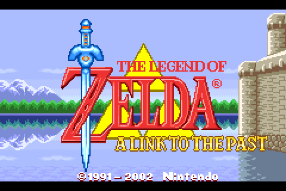
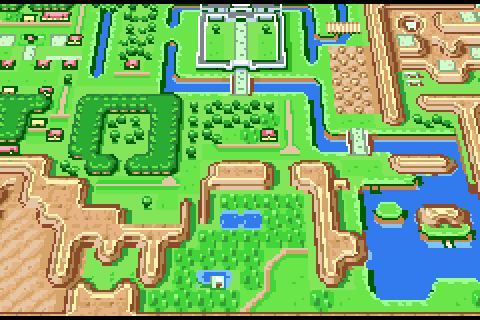
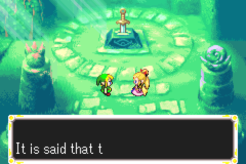
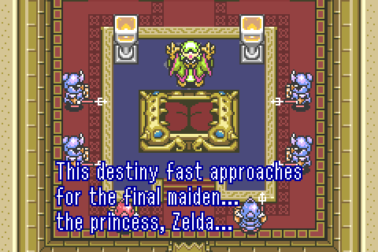

# gba-emulator

A Game Boy Advance emulator written in C, using SDL2 for video, audio and input.

It runs commercial and homebrew games at full speed with sound. The CPU is a plain interpreter (no recompiler) which is fast enough that a frame costs well under a millisecond on a modern machine.

## Screenshots

| | |
| --- | --- |
|  |  |
|  |  |

## Building

Needs a C11 compiler and SDL2.

```
brew install sdl2          # macOS
sudo apt install libsdl2-dev   # Debian/Ubuntu
```

Then:

```
make -j
```

Or with CMake:

```
cmake -B build && cmake --build build -j
```

## Running

```
./gba rom.gba
```

| Option | Meaning |
| --- | --- |
| `-b, --bios <file>` | use a real BIOS dump instead of the built-in replacement |
| `-s, --scale <n>` | window scale, default 3 |
| `--no-audio` | run without sound |
| `--frames <n>` | run n frames without opening a window, then exit |
| `--ppm <file>` | with `--frames`, write the last frame to a file |

### Controls

| Key | Button |
| --- | --- |
| Z / X | A / B |
| A / S | L / R |
| Arrows | D-pad |
| Enter | Start |
| Backspace | Select |
| Space | hold to fast-forward |
| Ctrl+R | reset |
| Esc | quit |

Battery saves are written next to the ROM as `.sav`, every few seconds and on exit.

## BIOS

No BIOS is included. By default the emulator uses a built-in replacement: the ~40 BIOS calls games actually use are implemented directly, along with a small interrupt dispatcher. That is enough for the large majority of games. If a game reads BIOS memory directly or depends on exact BIOS timing, pass your own dump with `--bios`.

ROMs are not included either. Use your own.

## What's emulated

- ARM7TDMI, both ARM and THUMB instruction sets, all seven processor modes
- Full memory map with mirroring, wait states and the 8-bit save bus
- All six video modes: text and affine backgrounds, both bitmap layouts, 128 sprites with affine transforms, windows, alpha blending, brightness effects, mosaic
- Four DMA channels including the sound FIFOs and HBlank/VBlank timing
- Four timers with prescalers, cascading and interrupts
- Four PSG channels plus both DirectSound FIFO channels
- SRAM, Flash (64K and 128K) and EEPROM (512B and 8K) saves, detected from the ROM

## Known gaps

- Timing is cycle-counted per memory access, not cycle-exact. The ROM prefetch buffer
  is not modelled, so a handful of timing-sensitive games may be off.
- No link cable, no RTC, no save states.
- Sprite mosaic is not applied (background mosaic is).

## References

- [GBATEK](https://problemkaputt.de/gbatek.htm)
- [ARM7TDMI Technical Reference Manual](https://developer.arm.com/documentation/ddi0210/c/)
- [Tonc](https://gbadev.net/tonc/)
